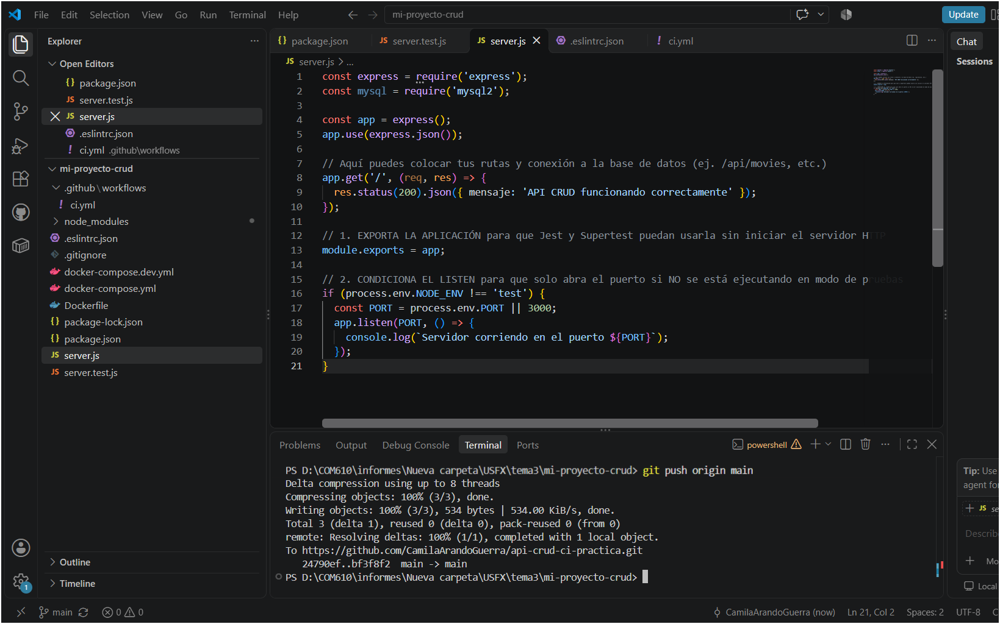
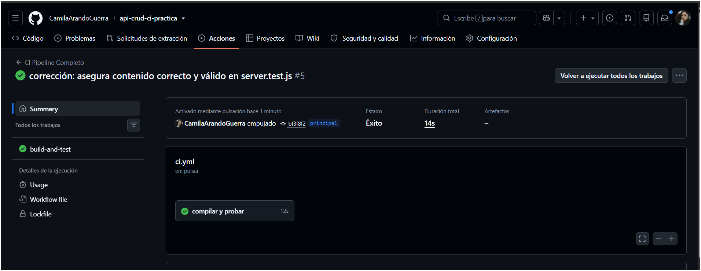
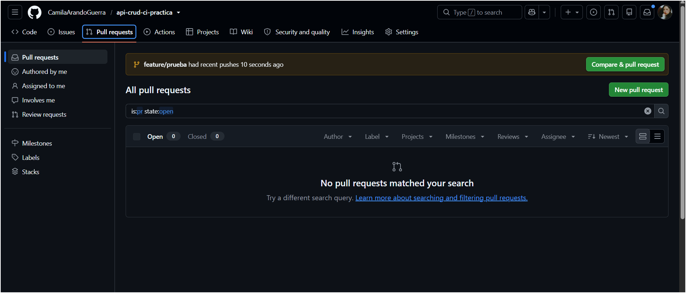
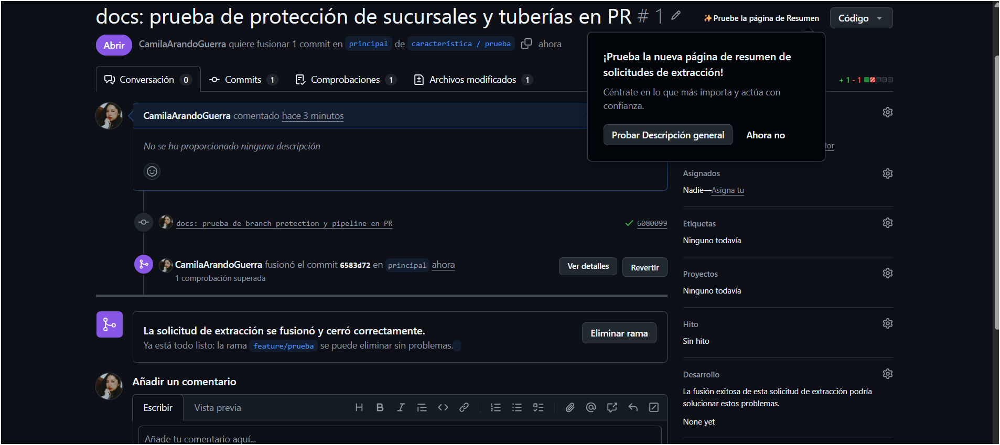

INFORME DE PRÁCTICA: IMPLEMENTACIÓN DE INTEGRACIÓN CONTINUA (CI/CD) EN UNA API CRUD
1. Datos Generales
Estudiante: Camila Arando Guerra

Carrera: Ingeniería de Sistemas

Facultad: Facultad de Tecnología

Universidad: Universidad Mayor, Real y Pontificia de San Francisco Xavier de Chuquisaca

Repositorio del Proyecto: api-crud-ci-practica

Tecnologías Utilizadas: Node.js, Express, Jest, GitHub Actions, Git y GitHub.

2. Introducción y Objetivos
El presente informe detalla el desarrollo e implementación de un pipeline de Integración Continua (CI) sobre una API CRUD construida en Node.js y Express. El propósito fundamental de esta práctica consistió en automatizar la ejecución de pruebas unitarias e de integración utilizando Jest, configurar directivas de control de versiones y establecer reglas estrictas de protección de ramas en GitHub para garantizar la calidad del software y prevenir la introducción de errores en la rama principal (main).

3. Desarrollo y Configuración del Proyecto
3.1. Estructura y Configuración del Entorno y Pruebas
Durante la fase inicial del proyecto, configuramos y depuramos la aplicación basada en Node.js y el framework Express. Se ajustaron las exportaciones del archivo principal (server.js) para permitir una correcta integración con el entorno de pruebas automatizadas utilizando Jest y Supertest, verificando que todas las rutas del CRUD funcionaran de manera óptima y respondieran adecuadamente a los requerimientos lógicos.

3.2. Automatización con GitHub Actions (CI Pipeline)
Se implementó un flujo de trabajo automatizado de Integración Continua mediante un archivo de configuración de GitHub Actions ubicado en .github/workflows/ci.yml. El pipeline se configuró para ejecutarse automáticamente ante cada evento de push o pull_request dirigido a la rama main, cumpliendo con las siguientes etapas:

Checkout del código: Extracción del repositorio en el entorno virtual de ejecución.

Configuración de Node.js: Establecimiento de la versión requerida para el motor de ejecución.

Instalación de dependencias: Ejecución de npm install para la obtención de los módulos necesarios.

Ejecución de pruebas: Lanzamiento de la suite de pruebas mediante el comando npm test con Jest.

4. Implementación de Seguridad y Protección de Ramas
Para garantizar un flujo de trabajo profesional y colaborativo, se configuraron reglas de protección de ramas (Classic Branch Protection Rules) directamente sobre la rama principal main en GitHub, aplicando las siguientes directrices:

Requerimiento de Pull Request: Se inhabilitaron los envíos directos (pushes) a main, obligando a que cualquier modificación se realice a través de una solicitud de extracción (pull request).

Verificación de Estados Obligatoria (Status Checks): Se configuró el pipeline build-and-test como un requisito indispensable que debe superarse satisfactoriamente antes de habilitar la fusión del código.

Pruebas de Validación mediante Rama Temporal (feature/prueba)
Para comprobar el funcionamiento del sistema de protección, llevé a cabo el siguiente procedimiento desde mi entorno local y remoto:

Creé y me trasladé a una rama de trabajo temporal:

PowerShell
git checkout -b feature/prueba
Realicé modificaciones documentales y de código, registrando los cambios:

PowerShell
git add .
git commit -m "docs: prueba de branch protection y pipeline en PR"
git push origin feature/prueba
Abrí una Pull Request desde feature/prueba hacia main en la plataforma de GitHub.

Como resultado de esta prueba, el sistema ejecutó automáticamente el pipeline de CI y bloqueó de forma inmediata el botón de fusión (Merging is blocked) hasta que las pruebas concluyeron de manera exitosa en verde (All checks have passed), momento en el cual procedí a fusionar los cambios de manera segura y eliminar la rama de prueba.
## 5. Evidencias Gráficas del Laboratorio

* **Figura 1:** Historial de ejecuciones exitosas del pipeline en la pestaña *Actions*.
  

* **Figura 2:** Vista de la Pull Request mostrando el estado y el bloqueo de fusión (*Merging is blocked*).
  

* **Figura 3:** Comprobación final del éxito de las verificaciones (*All checks have passed*).
  

* **Figura 4:** Fusión exitosa y cierre de la solicitud de extracción en la rama `main`.
  

6. Conclusiones
La automatización mediante GitHub Actions demostró ser una herramienta fundamental para asegurar que cada fragmento de código integrado cumpla con los estándares de calidad definidos mediante pruebas automatizadas con Jest.

Las políticas de protección de ramas y el bloqueo de solicitudes de extracción previenen errores críticos en producción, fomentando buenas prácticas de desarrollo de software en entornos colaborativos y empresariales.